# similFranz Monitor

Fa parte dell'**ecosistema similFranz**: tutti gli strumenti sulla [pagina similFranz](https://franz8787.github.io/similfranz/).

**Quel vecchio iPad mini® ha ancora molte vite da salvare. Per finta, e proprio per questo sul serio.**

Immagina la tua prossima simulazione: i partecipanti entrano, applicano gli elettrodi, e sul monitor compare
un ritmo. Lo guardano, decidono, caricano, erogano la scarica. Tu, a due passi, conduci lo scenario dal tuo
iPad e intanto il registro annota ogni azione, al secondo, per il debriefing.

Tutto questo con due iPad mini di dieci anni fa: uno fa il **monitor-defibrillatore**, l'altro la **regia
del facilitatore**. Si parlano direttamente, anche dove il Wi-Fi® è un ricordo.
Nessun abbonamento, nessun account, nessun costo ricorrente.

  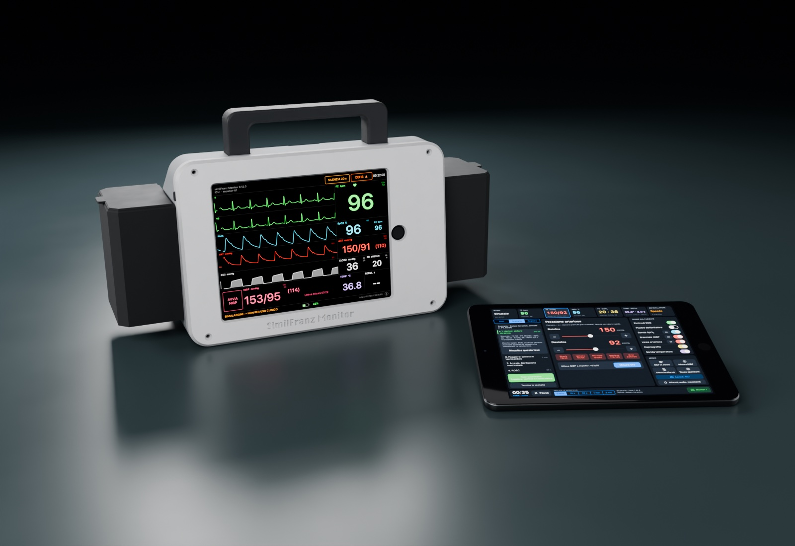

  <a href="docs/img/regia_video.mp4">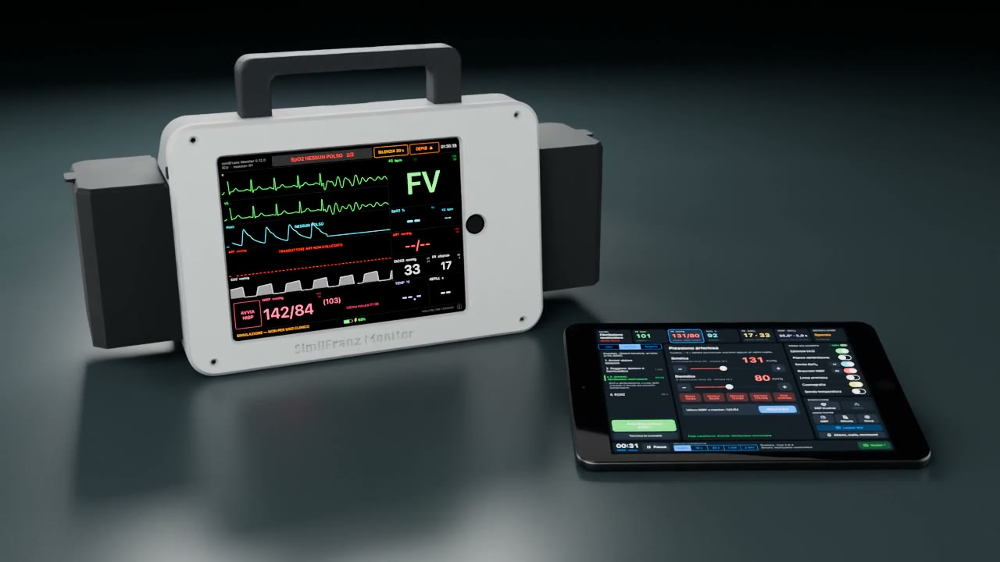</a> 
  Doppia visione, 16 secondi: dalla tachicardia alla FV, poi RCP. Tocca l'immagine per il video.

  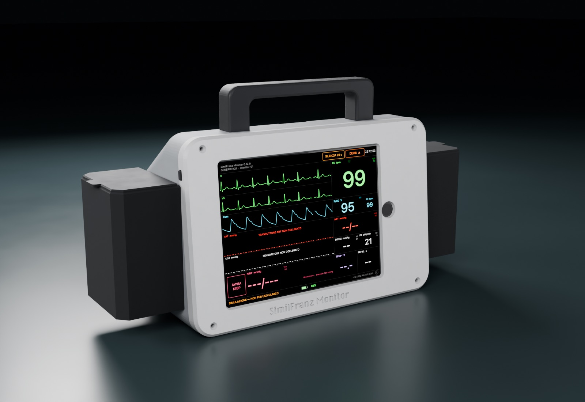

  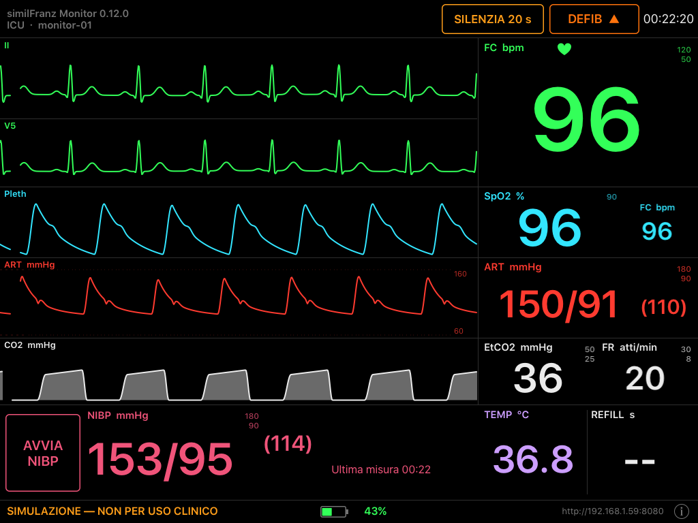
  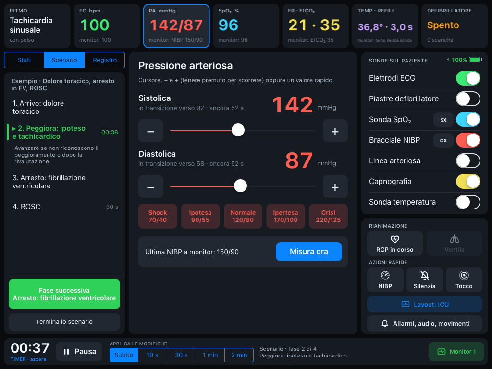

> **Solo per la simulazione sanitaria.** Non è un dispositivo medico, non misura e non eroga nulla:
> usalo esclusivamente in scenari formativi, mai su pazienti.

## Perché ti cambia la sessione

- **Fedeltà funzionale, quella che conta.** Il monitor risponde alle azioni come nella pratica clinica: la traccia
  compare quando applichi la sonda, la NIBP gonfia e misura, in arresto la saturazione sparisce e l'EtCO₂ crolla.
  I partecipanti ragionano sui dati, come faranno al letto del paziente.
- **I segnali clinici arrivano quando servono a te.** Dalla tua regia dai il *cue* giusto al momento giusto:
  un ritmo che cambia, una pressione che scende in trenta secondi, una sonda che perde il segnale.
- **Lo scenario lo conduci verso gli obiettivi di apprendimento.** Lo costruisci a fasi e decidi tu quando
  passare alla successiva: resti libero di seguire il gruppo, di rallentare, di ritoccare un parametro al volo.
- **Un defibrillatore con conseguenze.** Carica, scarica, sincronizzazione, pacing con soglia di cattura, DAE con
  voce guida. L'esito lo scegli tu: con regole impostate prima, oppure scarica per scarica.
- **Un debriefing che parte dai fatti.** Il registro annota da solo ciò che i partecipanti fanno sul dispositivo,
  comprese le scariche con la loro energia. Tu aggiungi con un tocco ciò che osservi: arresto riconosciuto,
  farmaci, punti di forza, punti da discutere. Alla fine hai i tempi delle azioni critiche e la cronologia:
  la base oggettiva su cui far riflettere il gruppo.
- **Libertà di movimento.** Sala di simulazione, reparto, ambulanza, palestra del corso: i due iPad® si collegano
  fra loro senza router e senza internet. E se il secondo iPad manca, la regia è una pagina web sul tuo computer,
  oppure il Pocket sull'iPod touch.

  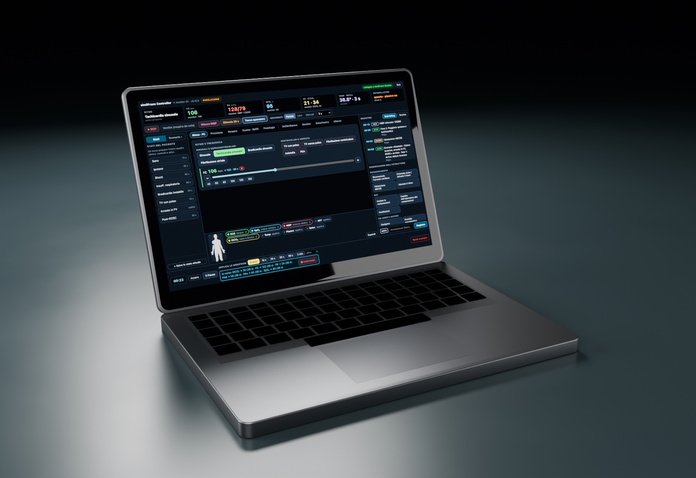

  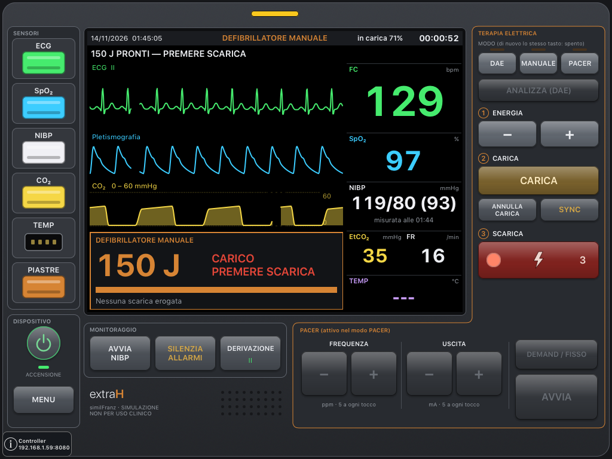
  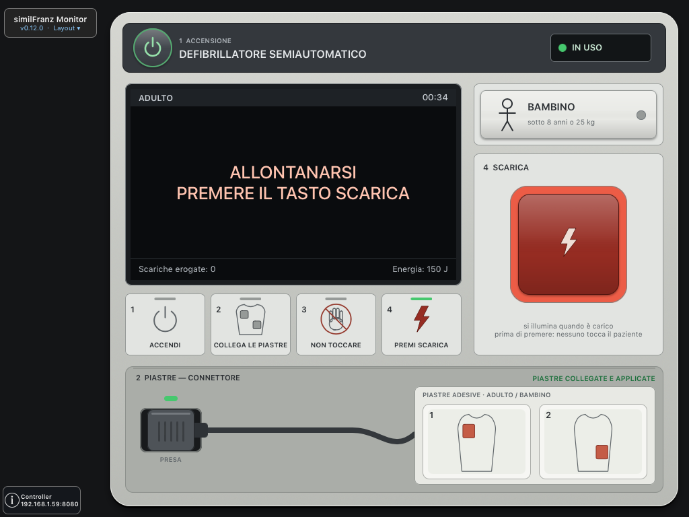
  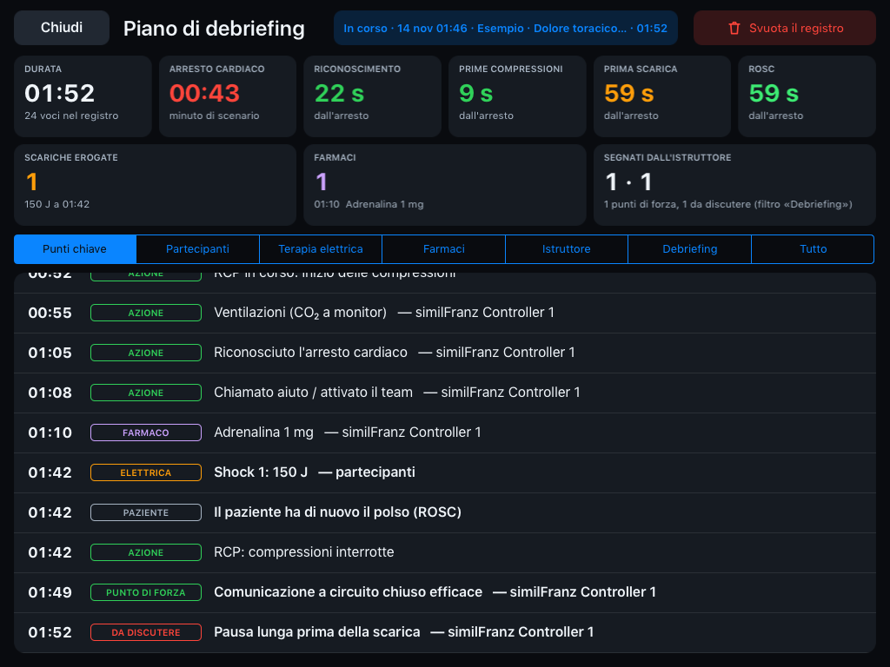

## La regia in tasca

Per le simulazioni volanti (*in situ*, in reparto, durante un corso affollato) c'è **similFranz Pocket**,
su un iPod touch® di 5ª generazione: un'app sola, verticale, da usare con il pollice mentre osservi il gruppo.

  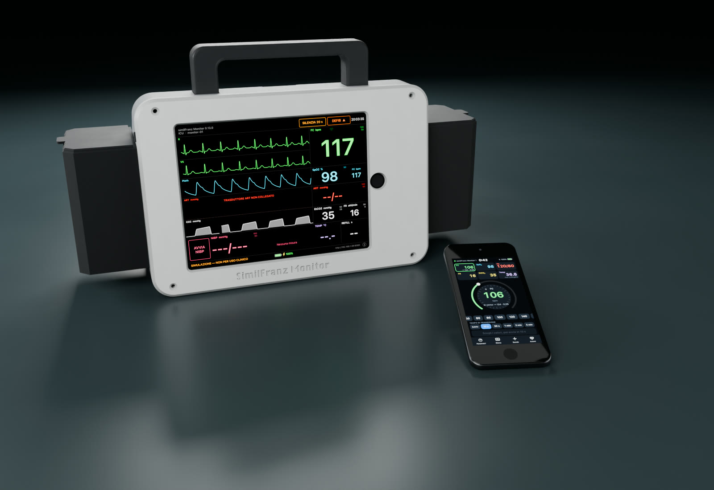

  <a href="docs/img/pocket_video.mp4">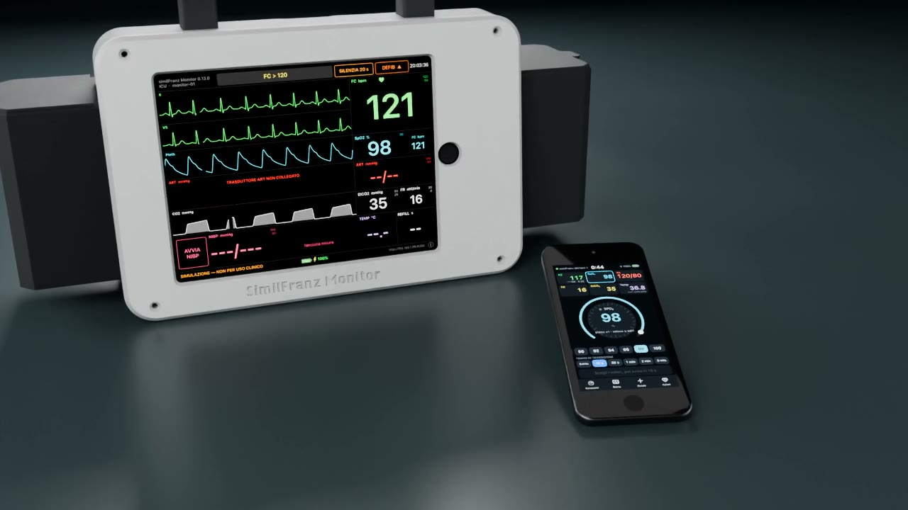</a> 
  Il Pocket in azione, velocità 2×: la FC sale a 124 in 10 s, la SpO₂ scende a 86, poi FV. Tocca l'immagine per il video.

- **La rotella.** Tocchi il parametro e lo giri: piano cambia di un'unità, veloce fa salti più grandi, e ogni
  scatto fa un clic. Intorno l'arco del valore, il pallino dove stai andando, la tacca dove sei adesso.
- **I valori clinici a un tocco.** Sotto la rotella, i valori che usi davvero: FC 40, 60, 100, 140…, PA 80/45 o 160/95.
- **Il tempo della transizione.** «Subito», oppure 10 s, 30 s, 1, 2, 5 minuti: le modifiche si mettono in coda
  e partono insieme con «Avvia». Sul riquadro del parametro vedi la meta e il conto alla rovescia.
- **Ritmo, sonde, RCP e ventilazioni, NIBP, Silenzia, Pausa, refill**: tutto a portata di pollice.

  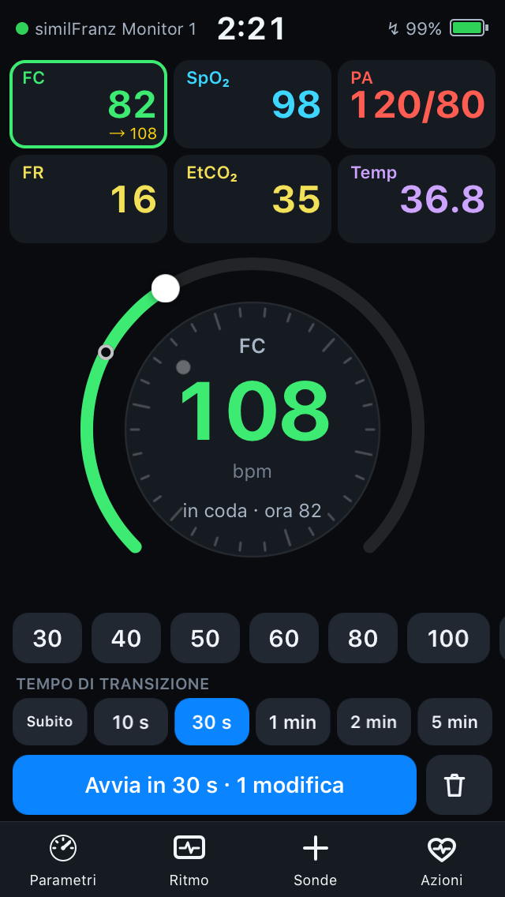
  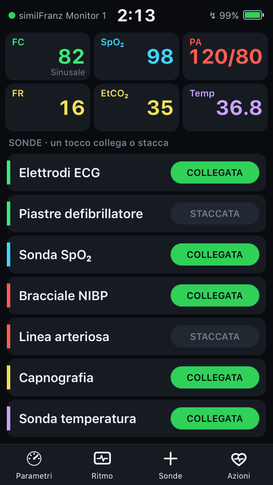
  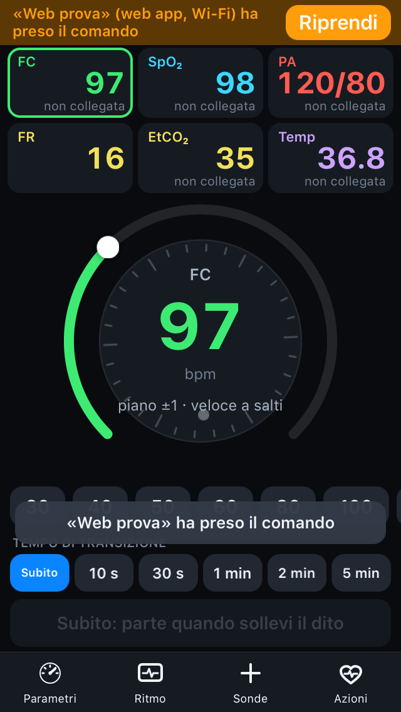

  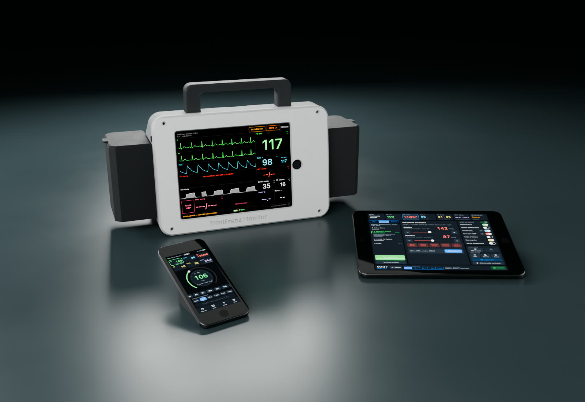

**Più regie, nessun conflitto.** Web app, iPad e iPod® possono essere collegati insieme. Comanda una regia alla volta,
con regole che tutti vedono: aprire una regia non toglie il comando a nessuno; chi ha dato un comando nell'ultimo minuto
è protetto e gli altri toccano «Prendi il comando»; chi è fermo da più di un minuto non blocca (il primo comando di
un'altra regia passa da solo). Chi perde il comando lo vede subito, con «Riprendi», e ogni passaggio resta nel registro.

## Tre dispositivi in uno

| Layout | Che cos'è | Quando lo usi |
|---|---|---|
| **ICU** | monitor da area critica, con defibrillatore a scomparsa | terapia intensiva, sala operatoria, degenza monitorata |
| **extraH** | monitor-defibrillatore da emergenza territoriale | soccorso extraospedaliero, pronto soccorso, trasporto |
| **DAE** | defibrillatore semiautomatico con voce guida | BLSD, primo soccorso, scenari con personale laico |

I tre layout sono **originali**, disegnati per questo progetto: allenano i gesti e il ragionamento, e restano
indipendenti da qualsiasi marca. Il sistema è aperto: un frontale su misura per le esigenze formative del tuo
centro si scrive partendo da uno di questi ([come si fa](docs/sviluppo.md#scrivere-un-layout)).

## Il metodo, prima dello strumento

similFranz nasce in sala di simulazione e ne segue il ciclo:

1. **Familiarizzazione.** Presenti il dispositivo al gruppo: come si accende, dove si collegano le sonde, che cosa può
   e che cosa non può fare. Chi conosce lo strumento si sente al sicuro, e chi si sente al sicuro impara.
2. **Scenario.** I partecipanti agiscono, tu faciliti: dai i segnali clinici, segui le loro decisioni, tieni lo
   scenario allineato agli obiettivi. Il registro lavora da solo.
3. **Debriefing.** Apri il piano di debriefing e parti dai fatti: «dall'arresto al riconoscimento sono passati
   sette secondi: che cosa vi ha fatto capire che il paziente era in arresto?». I dati aprono la riflessione,
   il gruppo la costruisce.

È uno strumento per **formatori, istruttori e facilitatori di simulazione**: fa una cosa sola, sostiene il tuo
lavoro, e ti lascia la mano libera per osservare le persone.

## Ce n'è uno in quasi ogni cassetto

In dieci anni Apple® ha venduto **oltre 500 milioni di iPad**. L'iPad mini è arrivato nel novembre 2012:
tre milioni di iPad in tre giorni, e secondo gli analisti due su tre erano mini. È rimasto in vendita fino al
2015. Apple non ha mai pubblicato i numeri per modello, ma una stima prudente parla di **decine di milioni
di iPad mini di prima generazione** ancora in giro per il mondo.

Dal 2016 quel modello è fermo a iOS 9: niente più aggiornamenti, sempre meno app. Per chi lo possiede è un
soprammobile. Per la simulazione è perfetto: uno schermo da 7,9 pollici, un altoparlante, il Wi-Fi, una
batteria che regge una sessione, e sull'usato si trova a poche decine di euro.

Ogni iPad che torna in sala è un dispositivo in meno tra i rifiuti elettronici: nel 2022 il mondo ne ha
prodotti 62 milioni di tonnellate, e solo il 22,3% è stato raccolto e riciclato in modo documentato.

Fonti: oltre 500 milioni di iPad in dieci anni, Apple, settembre 2020 ([AppleInsider](https://appleinsider.com/articles/20/09/15/apple-has-sold-a-total-of-500-million-ipads-in-the-last-10-years));
tre milioni di iPad nel fine settimana di lancio ([AppleInsider](https://appleinsider.com/articles/12/11/05/apple-announces-sales-of-ipad-mini-fourth-gen-ipad-reach-3m))
e stime degli analisti sulla quota dei mini ([Fortune](https://fortune.com/2012/11/05/apples-3-million-ipad-weekend-what-the-analysts-are-saying/));
rifiuti elettronici ([Global E-waste Monitor 2024, UNITAR](https://unitar.org/index.php/about/news-stories/press/global-e-waste-monitor-2024-electronic-waste-rising-five-times-faster-documented-e-waste-recycling)).
Il numero di iPad mini di prima generazione è una stima: Apple non pubblica le vendite per modello.

## Un guscio che lo rende un monitor

  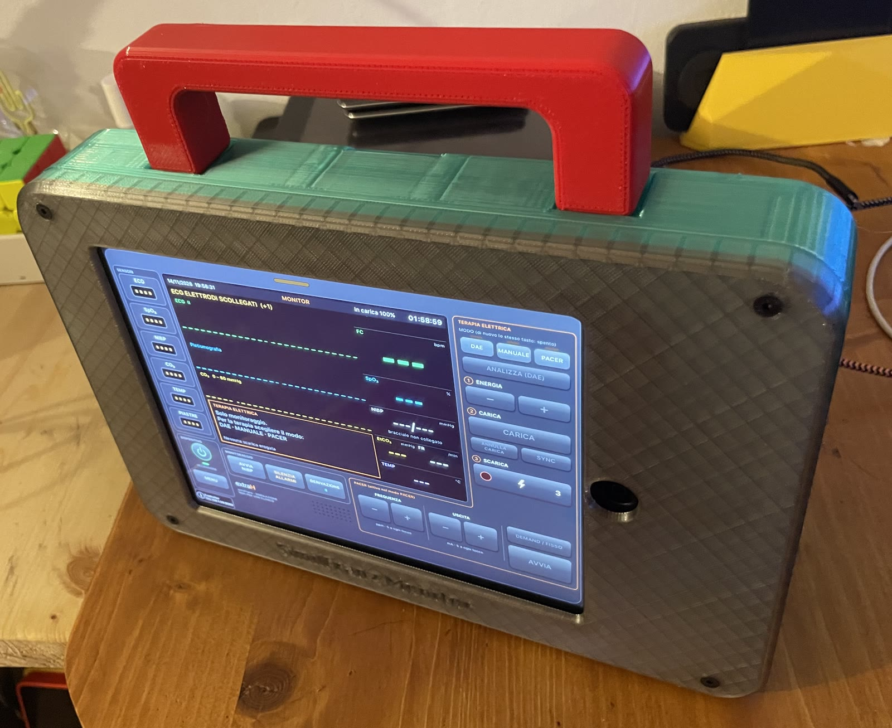
  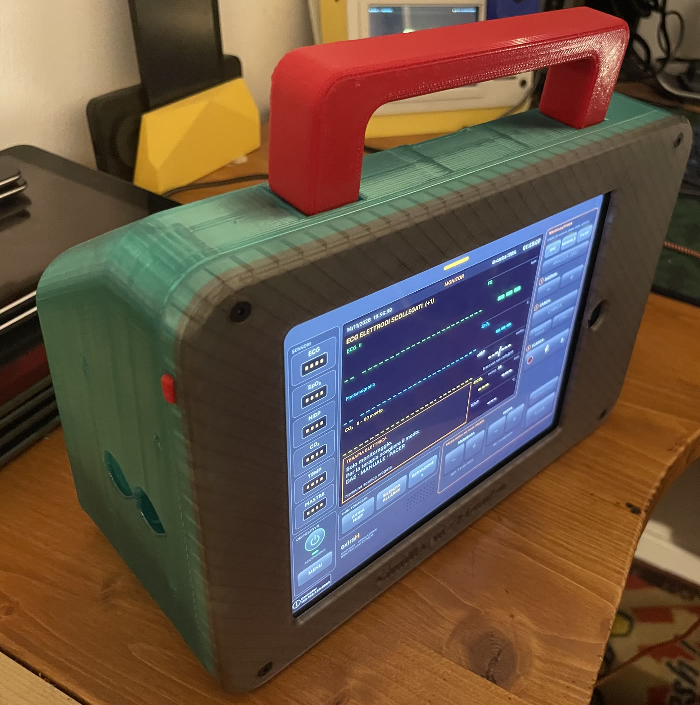

Il prototipo vero, stampato in casa: i colori sono quelli dei filamenti che avevo sul piatto.

  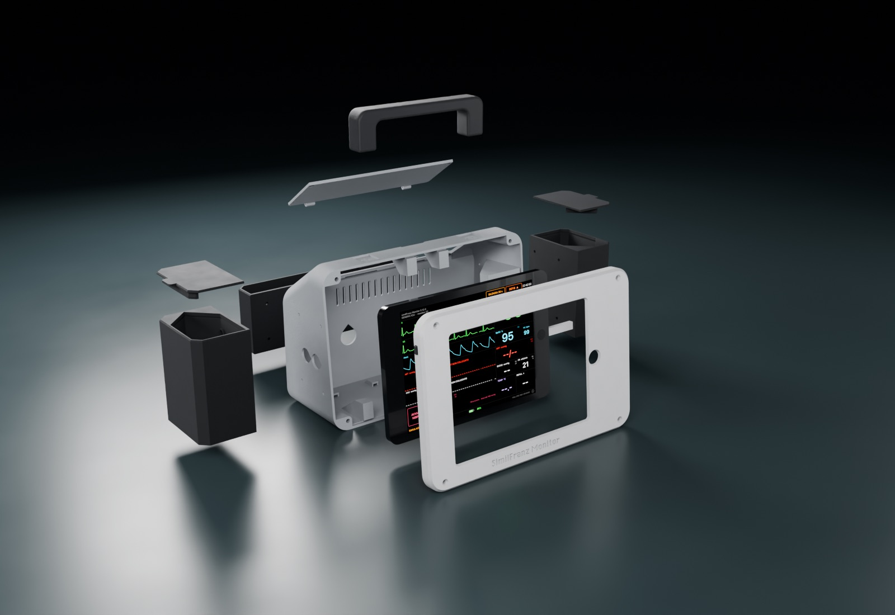
  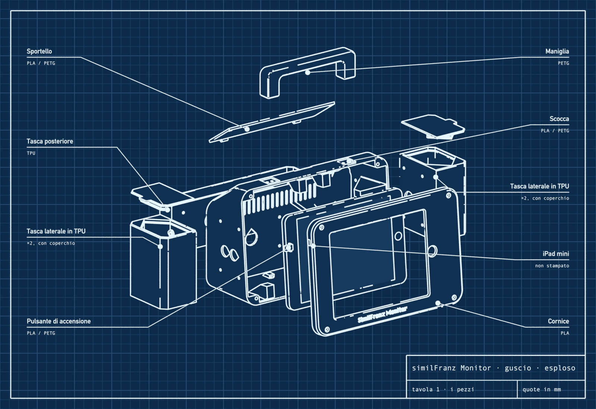

Con una stampante 3D l'iPad diventa un monitor trasportabile: maniglia, schermo inclinato, tasche in TPU per
cavi e sonde, sportello posteriore per la ricarica. I partecipanti lo afferrano, lo appoggiano accanto al
manichino e ci collegano i cavi veri. File e istruzioni in [Stampa e monta il guscio](docs/04-guscio.md).

## Che cosa ti serve

- **Un iPad mini di 1ª generazione** con iOS 9.3.5 o 9.3.6 per il monitor (modelli A1432, A1454, A1455)
- facoltativo: **un secondo iPad mini 1** per la regia; in alternativa basta un browser
- facoltativo: **un iPod touch di 5ª generazione** (iOS 9.3.5) per la regia tascabile
- **un Mac® o un PC Linux®**, una volta sola con il cavo, per la prima installazione: dopo, gli aggiornamenti arrivano dalla regia web
- facoltativo: **una stampante 3D** per il guscio

Account sviluppatore, abbonamenti, internet durante l'uso: zero.

## Quattro passi, un fine settimana

1. [Sblocca l'iPad](docs/01-jailbreak.md): una volta sola, dal browser dell'iPad.
2. [Installa da zero](docs/02-installazione.md): un comando dal computer per ogni dispositivo, con il cavo.
3. [Porta lo scenario in sala](docs/03-uso.md): collegamento, regia, scenari a fasi, debriefing.
4. [Stampa e monta il guscio](docs/04-guscio.md): quando vuoi che sembri, e si maneggi, come un monitor.

Poi: [Aggiorna](docs/05-aggiornamenti.md), dalla regia web, senza cavi.

Vuoi metterci le mani? In [Per sviluppatori](docs/sviluppo.md) trovi come si compila senza Xcode®,
l'API del monitor e come si scrive un layout nuovo.

**Non ti va di usare il Terminale?** Con [Claude Code](docs/06-claude-code.md) basta il link di questa pagina:
*"Installa similFranz da https://github.com/Franz8787/similfranz-monitor, ho monitor, controller e Pocket"*.
Lui scarica, installa e ti dice quando collegare ogni dispositivo; tu scrivi solo la password e fai i tocchi.
Funziona anche per il [saturimetro](https://github.com/Franz8787/similfranz-saturimetro), o per tutto insieme.

## Un ecosistema che cresce

similFranz è un ecosistema di vecchi dispositivi Apple che tornano utili alla simulazione.
Il primo è stato il [saturimetro su iPod touch 4](https://github.com/Franz8787/similfranz-saturimetro).
Metti una stella al progetto: sarai tra i primi a vedere il prossimo.

## Sempre aggiornato, senza cavi

Quando esce una versione nuova, la regia web sul computer te lo dice e, con un clic, aggiorna il monitor.
Il monitor conserva anche le versioni nuove di controller e iPod e gliele passa al loro prossimo collegamento,
anche senza rete. Niente cavi, niente file da spostare. Passo per passo in [Aggiorna](docs/05-aggiornamenti.md).

## Fallo tuo

Costruiscilo, portalo nei tuoi scenari e racconta che cosa hai migliorato: apri una *issue* o proponi una
modifica. Ogni idea che arriva dalla sala rende lo strumento migliore per tutta la comunità della simulazione.

**Non serve un Mac per fare la tua versione.** Fai una copia del progetto (*Fork*), attiva *Actions* e *Pages*,
modifica quello che vuoi direttamente su GitHub® e pubblica una *Release*: GitHub compila le tre app da solo e le
mette a disposizione. I monitor installati dalla tua copia si aggiornano con le **tue** versioni.
I passi sono in [Per sviluppatori › Fai la tua versione](docs/sviluppo.md#fai-la-tua-versione-senza-mac).

## Da sapere

- **È un simulatore per la formazione**: non è un dispositivo medico e non sostituisce alcuno strumento clinico.
- **È indipendente**: non è affiliato né approvato da alcun produttore di monitor o defibrillatori, e i layout sono originali.
- Il jailbreak modifica il software dell'iPad: usa un dispositivo dedicato, senza dati personali.
- Le password predefinite dopo il jailbreak sono note a tutti: tieni l'iPad su reti di cui ti fidi.
- Apple®, iPad®, iPad mini®, iPod®, iPod touch®, iPhone®, Mac®, macOS®, Safari®, Finder®, Xcode® e iCloud® sono marchi
  di Apple Inc., registrati negli Stati Uniti e in altri Paesi; App Store® è un marchio di servizio di Apple Inc.;
  Lightning è un marchio di Apple Inc. Sono citati solo per indicare i dispositivi e i programmi compatibili.
  IOS è un marchio o marchio registrato di Cisco negli Stati Uniti e in altri Paesi, usato su licenza.
  GitHub® è un marchio di GitHub, Inc.; Wi-Fi® di Wi-Fi Alliance; Bluetooth® di Bluetooth SIG, Inc.; Linux® di Linus Torvalds.
  Gli altri nomi di prodotti e aziende appartengono ai rispettivi titolari. Il progetto è indipendente: non è affiliato, sponsorizzato né approvato da nessuno di questi titolari.
- La figura del paziente nella pagina web è di Goran tek-en (Wikimedia Commons), licenza CC BY-SA 4.0.

## Come citarlo

Se similFranz ti è utile in un corso, un poster, una tesi o un articolo, usalo liberamente: è nato per questo.
Citarlo è il modo più semplice per far sapere ad altri formatori, istruttori e facilitatori di simulazione che esiste,
e per tenere unita la rete di chi lo usa. E se lo migliori, raccontacelo qui su GitHub: segnalazioni
([issue](https://github.com/Franz8787/similfranz-monitor/issues)), idee e modifiche sono benvenute, così il lavoro di uno diventa di tutti.

Se lo usi in un corso, un poster o un articolo, trovi la citazione pronta con il pulsante
**Cite this repository** qui su GitHub (file [`CITATION.cff`](CITATION.cff)). Ogni versione è archiviata
su [Zenodo](https://zenodo.org), l'archivio scientifico del CERN, con un DOI permanente:
[doi.org/10.5281/zenodo.24232019](https://doi.org/10.5281/zenodo.24232019) (punta sempre all'ultima versione).

> Palmisano, F. (2026). *similFranz Monitor: un simulatore di monitor multiparametrico e defibrillatore a basso costo,
> basato sul riuso di tablet dismessi, per la simulazione sanitaria*. Zenodo. https://doi.org/10.5281/zenodo.24232019

## Licenza

Codice e documentazione: [GPL-3.0](LICENSE). Modelli 3D del guscio (cartella `stampa3d/`): [CC BY-NC 4.0](stampa3d/LICENSE).
Sviluppato da Francesco Palmisano (ilFranz) con Claude Code.
