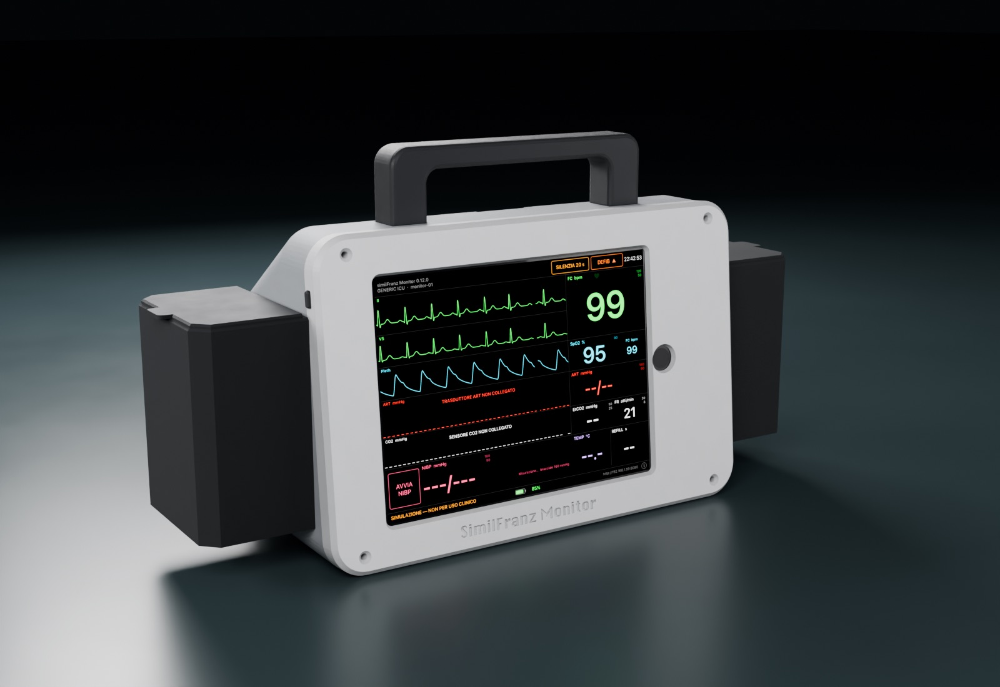
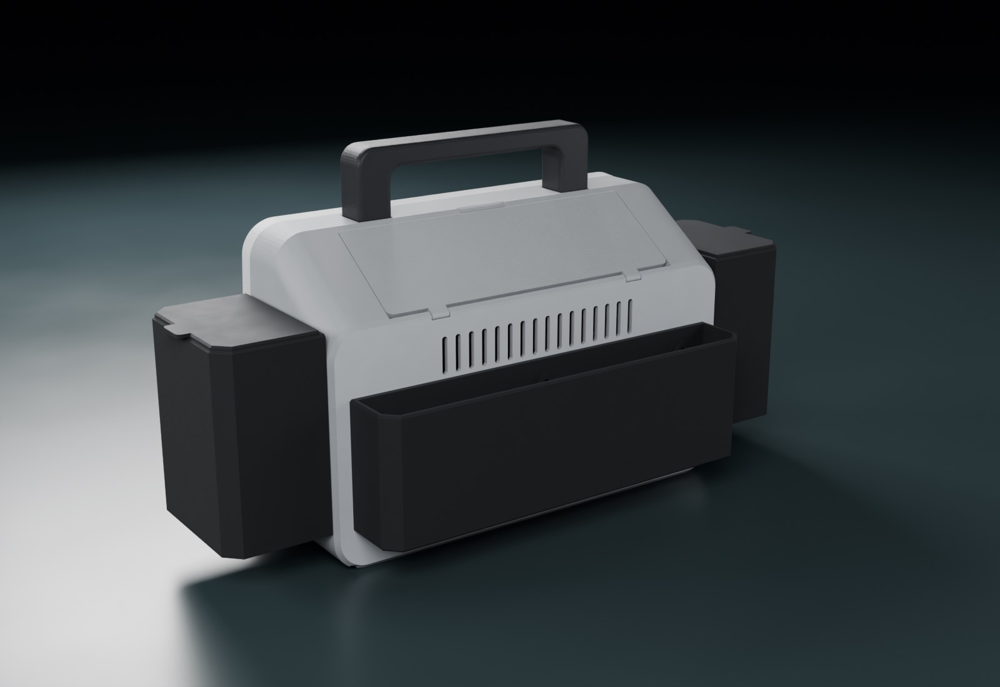
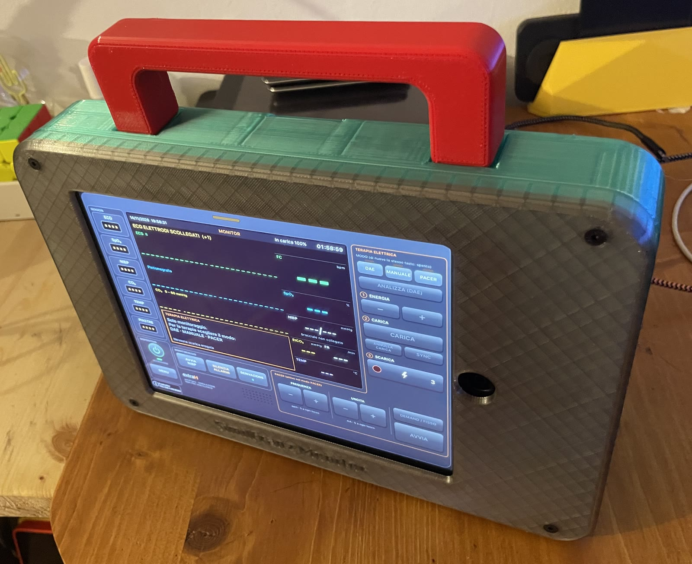
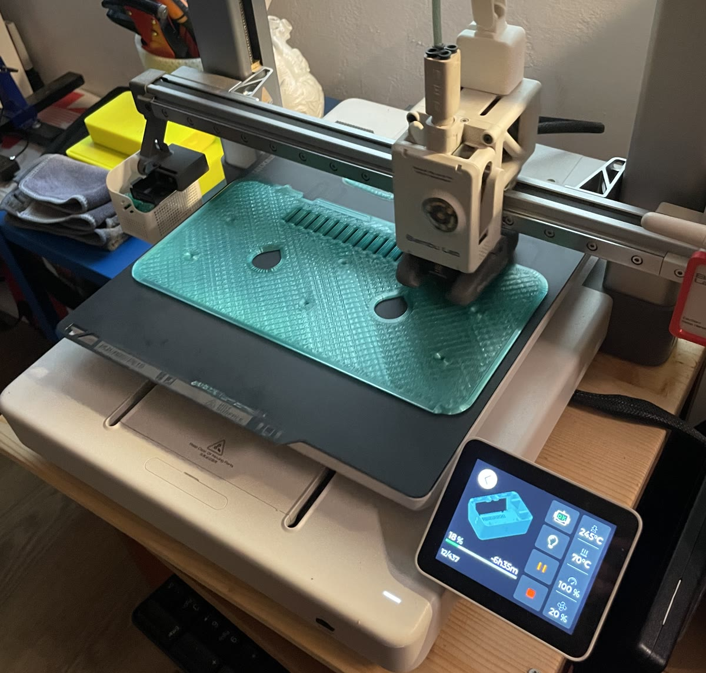
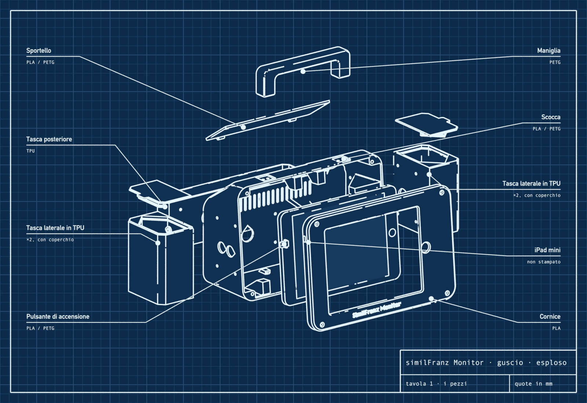
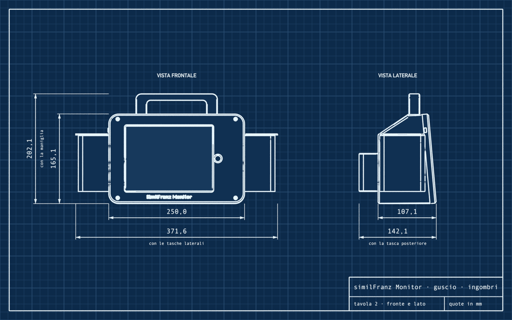
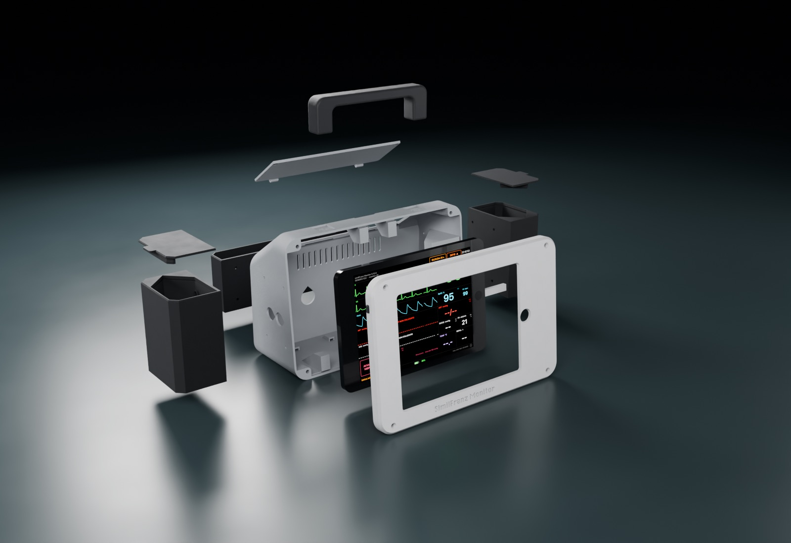
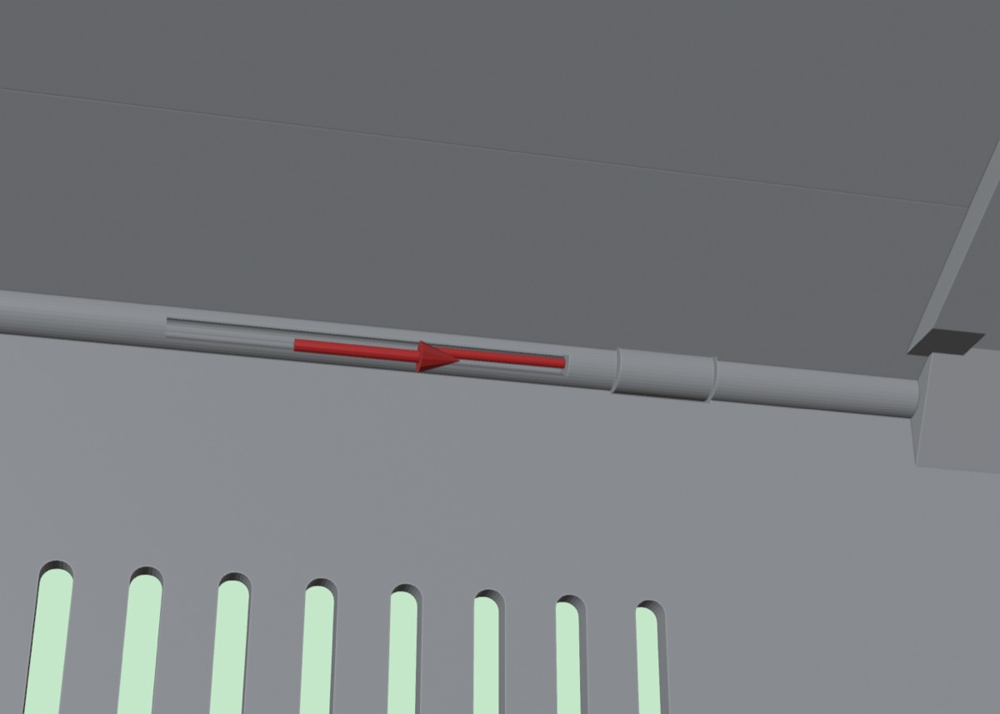

# 4 · Stampa e monta il guscio (facoltativo)

Il monitor funziona anche con l'iPad® appoggiato a un leggio. Ma un monitor da simulazione si prende per la
maniglia, si sposta dal carrello al letto, si collega alle sonde: il guscio serve a questo. È il momento in cui
l'iPad smette di sembrare un iPad.

<p align="center">
  
  
</p>

<p align="center">
  
  
</p>
<p align="center"><sub>Il prototipo vero e la scocca in stampa: i colori sono liberi, conta la forma.</sub></p>

Sette pezzi stampati, nessuna colla tranne che per i magneti. Lo schermo è inclinato di 5° all'indietro e il
fondo è piatto. Dallo sportello sul retro entra una mano: lì dentro stanno il cavo di ricarica e, se vuoi,
i connettori veri di sonde ed elettrodi che i partecipanti collegano davvero.

<p align="center"></p>

## Quanto è grande

<p align="center"></p>

Guscio 250 × 107 × 165 mm; 202 mm di altezza con la maniglia, 372 mm di larghezza con le tasche laterali,
142 mm di profondità con la tasca posteriore. **La cornice è larga 250 mm: serve un piatto da almeno 256 × 256 mm.**

## I file

| File | Che cosa contiene |
|---|---|
| `stampa3d/stl/monitor_cornice_v7.stl` | cornice frontale, già a faccia in giù |
| `stampa3d/stl/monitor_scocca_v8.stl` | scocca, già col retro sul piatto |
| `stampa3d/stl/monitor_sportello_v4.stl` | sportello posteriore |
| `stampa3d/stl/monitor_maniglia_v4.stl` | maniglia |
| `stampa3d/stl/monitor_pulsante_accensione_v6.stl` | pistoncino del tasto di accensione |
| `stampa3d/stl/monitor_tasche_laterali_x2_v8.stl` | le due tasche laterali in TPU |
| `stampa3d/stl/monitor_tasca_posteriore_v8.stl` | la tasca posteriore in TPU |
| `stampa3d/sorgenti/monitor_guscio.py` | script parametrico per Blender: cambi una misura e rigeneri tutto |

Tasche e maniglia sono indipendenti: puoi partire con cornice, scocca, sportello e pulsante e aggiungere il resto dopo.

## Stampa

Gli STL sono già orientati. Il progetto è nato su una **Bambu Lab A1 con ugello 0,4**, profilo 0,20 mm.

| Pezzo | Materiale | Supporti |
|---|---|---|
| Cornice | PLA bianco | solo sotto i due fermi a L del fianco sinistro (due tetti a sbalzo di 9 mm) |
| Scocca | PLA o PETG | ad albero, sotto il bordo alto dell'apertura dello sportello |
| Sportello | come la scocca | nessuno |
| Maniglia | PETG grigio scuro | nessuno |
| Pulsante di accensione | PLA o PETG | nessuno |
| Tasche laterali e posteriore | TPU 95A | nessuno |

Per il TPU le impostazioni contano: sono tutte in [`stampa3d/STAMPA_TASCHE_TPU.md`](../stampa3d/STAMPA_TASCHE_TPU.md).
Sulla A1 il TPU va sul portabobina esterno, non nell'AMS lite.

Sul bordo basso della cornice trovi la scritta incisa **SimilFranz Monitor**: con lo script la sostituisci con la tua.

## La minuteria

- 8 **inserti filettati a caldo M3 × 5 × 5 mm**: 4 in cima alle colonne d'angolo della scocca, 4 sotto i piedini della maniglia
- 4 **viti M3 × 16 a testa svasata**: chiudono la cornice sulla scocca, da davanti
- 4 **viti M3 × 12**: maniglia, dall'interno
- 14 **viti M3 × 8** e 14 **dadi M3**: tasche laterali (4 + 4) e tasca posteriore (6)
- 2 pezzi di **graffetta raddrizzata** (Ø 1 mm circa, lunghi 25 mm): i perni dello sportello
- 4 **magneti 5 × 2 mm**: la chiusura dello sportello
- qualche **feltrino o gommino adesivo da 1 mm**
- un **cavo Lightning con la spina a 90°**

## Monta

<p align="center"></p>

1. **Togli i supporti** dai due fermi a L della cornice e dall'apertura dello sportello.
2. **Posa gli inserti.** Saldatore a circa 220 °C (PLA): 4 inserti in cima alle colonne d'angolo della scocca e
   4 sotto i piedini della maniglia. Lasciali scendere col loro peso fino a filo.
3. **Maniglia.** I piedini entrano negli scassi del tetto della scocca: 4 viti M3 × 12 dall'interno.
4. **Tasche** (se le usi). Spingi i dadi nelle sedi esagonali del dorso, dall'interno della tasca: il TPU li trattiene.
   Poi le viti M3 × 8 con la testa dentro la scocca. Va fatto **prima** di chiudere la cornice. Stringi solo
   finché la tasca appoggia: il TPU stretto troppo si deforma.
5. **Sportello.** Appoggialo nella sua apertura, con le due nocche allineate ai cilindri della scocca.
   Dall'interno, con la mano dentro dall'apertura, posa un pezzo di graffetta nella scanalatura sul lato interno
   del cilindro e spingilo verso l'esterno fino in fondo: è il perno. Uno per lato.

   
6. **Magneti.** Due nello sportello, due nelle battute laterali della scocca. Prima di incollarli controlla
   che si attraggano, poi una goccia di colla cianoacrilica.
7. **Feltrini** sulle "dita" della scocca e sotto i due fermi a L della cornice: tengono l'iPad premuto senza segnarlo.
8. **Pulsante.** Infila il pistoncino nel suo canale sul fianco sinistro della cornice.
9. **iPad.** Entra inclinato di circa 5°, col fianco del tasto di accensione sotto i due fermi a L; poi lo abbassi
   nella cornice, col tasto Home a destra. Collega il cavo Lightning a 90° e fallo uscire dal retro.
10. **Chiudi.** Appoggia la scocca alla cornice e avvita le 4 viti M3 × 16 da davanti, negli angoli.

Il tasto di accensione si preme dal pistoncino. Il volume si regola da iOS: Centro di Controllo, oppure
AssistiveTouch › Dispositivo › Volume.

## Rigenera il guscio a modo tuo

Con [Blender](https://www.blender.org), anche senza aprirlo:

```bash
cd stampa3d/sorgenti
/Applications/Blender.app/Contents/MacOS/Blender --background --python monitor_guscio.py
```

In cima allo script trovi tutti i parametri: giochi attorno all'iPad, inclinazione dello schermo, sportello,
maniglia, tasche, testo inciso.

Guscio chiuso? Torna a [Porta lo scenario in sala](03-uso.md).
